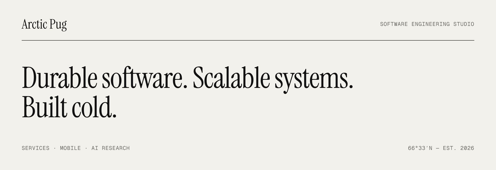

<picture>
  <source media="(prefers-color-scheme: dark)" srcset="./assets/banner-dark.png">
  <source media="(prefers-color-scheme: light)" srcset="./assets/banner-light.png">
  
</picture>

 

**Arctic Pug** is a software engineering studio. We design and operate high-performance services and native mobile applications, and conduct applied AI research — engineered for scale, low latency and long service life.

 

|  | What we do |  |
| :-- | :-- | --: |
| **Services** | Distributed backends. Low-latency, horizontally scalable, observable by default. | `INFRASTRUCTURE` |
| **Mobile** | Native applications for iOS and Android, built on shared high-performance cores. | `APPLICATIONS` |
| **AI research** | Applied research in machine learning, from experiments to models running in production. | `INTELLIGENCE` |

 

> **Durable by design.** Systems built to run for years, not quarters. 
> **Scalable from day one.** Architectures that grow horizontally, without rewrites. 
> **Private by default.** We collect the minimum required to operate, and we never sell data.

 

`ARCTIC PUG LLC` · New Mexico, USA · [arcticpug.com](https://arcticpug.com) · [hello@arcticpug.com](mailto:hello@arcticpug.com)

